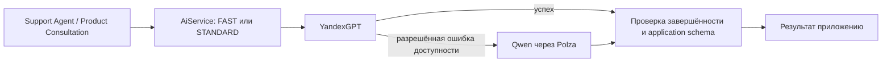
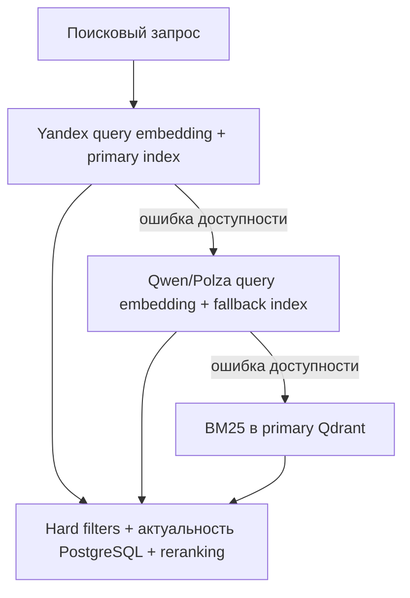

# AI-провайдеры: эксплуатация, fallback и индексы

Актуальное руководство для `refactor/ai-provider-abstraction`, 26 октября 2026 года. Целевая конфигурация: YandexGPT для FAST/STANDARD, Qwen через Polza как резерв. Embeddings переключаются независимо. Этот документ заменяет эксплуатационные инструкции в исторических отчётах `infra/` и `src/ai/README.md`.

## 1. Архитектура и границы

Приложение продолжает вызывать `AiService.getChatModel('FAST' | 'STANDARD')`. Роль описывает назначение модели, а не поставщика. `AiService` один раз создаёт и кеширует модель для каждой роли. Изменение `.env` требует перезапуска процесса. `STRONG` зарезервирован и не используется.



`chat-presets.ts` — небольшой список именованных deployments. `chat-transport.ts` задаёт параметры API, `chat-http.ts` проверяет завершённость HTTP-ответа до использования результата, `chat-fallback.ts` допускает максимум одну дополнительную модельную попытку. LangGraph, инструменты, Workspace и доменные правила не перенесены в этот слой.

OpenAI, Yandex и Qwen используют существующий `ChatOpenAI`. GigaChat использует существующий `DirectGigaChat`. LiteLLM, Python hooks, бюджетная БД и дополнительные сервисы в runtime отсутствуют. Экспериментальные материалы сохранены отдельно и не являются обязательным CI.

## 2. Именованные конфигурации и приоритет

| Имя | Производитель / сервис доступа | Model ID | API / ключ |
| --- | --- | --- | --- |
| `yandex-lite` | Yandex / Yandex | Значение `YANDEX_LITE_MODEL` | Chat Completions, `YANDEX_API_URL`, `YANDEX_API_KEY` |
| `yandex-standard` | Yandex / Yandex | Значение `YANDEX_MODEL` | Тот же транспорт |
| `qwen-flash` | Qwen / Polza | `qwen/qwen3.8-flash` | `https://polza.ai/api/v1`, Chat Completions, `POLZA_API_KEY` |
| `qwen-max` | Qwen / Polza | `qwen/qwen3.8-max` | Тот же транспорт |
| `gpt-6-luna` | OpenAI / OpenAI | `gpt-6-luna` | Responses, `OPENAI_API_KEY` |
| `gpt-6.1-sol` | OpenAI / OpenAI | `gpt-6.1-sol` | Responses, `OPENAI_API_KEY` |
| `gigachat-2` | GigaChat / Sber | `GigaChat-2` | Native v1, `GIGACHAT_CREDENTIALS` либо `GIGACHAT_ACCESS_TOKEN` |

Новый `CHAT_FAST`/`CHAT_STANDARD` имеет приоритет **над всем набором** legacy PROVIDER/MODEL/TRANSPORT_PROFILE этой роли. Указанный alias не смешивается со старым model ID или профилем. Неизвестное либо пустое имя — ошибка, не автоматический выбор другого провайдера.

Если alias отсутствует, сохранён прежний порядок: `CHAT_<ROLE>_PROVIDER`, затем `CHAT_PROVIDER`; `CHAT_<ROLE>_MODEL`, затем соответствующие `YANDEX_LITE_MODEL`/`YANDEX_MODEL` или `OPENAI_FAST_MODEL`/`OPENAI_STANDARD_MODEL`. Для Qwen и GigaChat legacy model ID обязателен. Явный role profile имеет приоритет над старым OpenAI role profile.

Для резерва аналогично: `CHAT_<ROLE>_FALLBACK` имеет приоритет над `CHAT_<ROLE>_FALLBACK_PROVIDER/MODEL/TRANSPORT_PROFILE`. Если обе формы отсутствуют, fallback выключен. Чтобы выключить его, **удалите переменные**, а не присваивайте пустую строку. Ключи неиспользуемых провайдеров не нужны. Явно настроенный fallback требует своего ключа при первом создании модели роли.

Alibaba и Polza — разные подключения к Qwen. Старый `qwen-chat` использует `QWEN_API_URL`, `QWEN_API_KEY` и `enable_thinking:false`. Новый `polza-chat` использует Polza URL/ключ и не отправляет этот параметр. Legacy custom model ID через Polza можно задать вместе с `CHAT_<ROLE>[_FALLBACK]_TRANSPORT_PROFILE=polza-chat`. Так добавление новой совместимой модели не требует изменения TypeScript; запись в реестре нужна лишь для нового короткого имени.

## 3. Готовая конфигурация

Сначала сохраните защищённую копию **своего** рабочего `.env`. Пример ниже дополняет его; строки Yandex необходимо оставить с существующими рабочими значениями. Секреты в Git не добавляются. Полный шаблон: [`src/ai/.env.example`](../src/ai/.env.example).

```dotenv
CHAT_MODE=direct
CHAT_FAST=yandex-lite
CHAT_STANDARD=yandex-standard
CHAT_FAST_FALLBACK=qwen-flash
CHAT_STANDARD_FALLBACK=qwen-max
CHAT_REQUEST_TIMEOUT_MS=60000
POLZA_API_KEY=<секрет окружения>
YANDEX_API_KEY=<существующий секрет>
YANDEX_API_URL=https://ai.api.cloud.yandex.net/v1
YANDEX_LITE_MODEL=gpt://YOUR_FOLDER/yandexgpt-lite/latest
YANDEX_MODEL=gpt://YOUR_FOLDER/yandexgpt/latest

EMBEDDING_PROVIDER=yandex
EMBEDDING_FAILOVER_ENABLED=false
EMBEDDING_FALLBACK_PROVIDER=qwen
EMBEDDING_REQUEST_TIMEOUT_MS=60000
QDRANT_REQUEST_TIMEOUT_MS=60000
QWEN_EMBEDDING_MODEL=qwen/qwen3-embedding-4b
QWEN_EMBEDDING_DIMENSIONS=2560
QDRANT_PRODUCTS_SECONDARY_COLLECTION=products_fallback
QDRANT_KNOWLEDGE_SECONDARY_COLLECTION=store_knowledge_fallback
```

`YANDEX_FOLDER_ID`, `YANDEX_EMBEDDING_QUERY_MODEL`, `YANDEX_EMBEDDING_DOCUMENT_MODEL`, размерность и auth сохраняются из рабочего окружения. `YANDEX_EMBEDDING_AUTH_TYPE` по умолчанию `iam` (Bearer); для API-ключа явно используется `api-key`. Primary `ProductEmbedding` в PostgreSQL остаётся vector(768). Его нельзя менять вместе с выбором chat-модели.

Примеры ручного переключения после перезапуска:

```dotenv
# Только STANDARD на Qwen:
CHAT_STANDARD=qwen-max
# Удалить CHAT_STANDARD_FALLBACK и legacy FALLBACK_* этой роли, если резерв не нужен.

# Обе роли на Qwen:
CHAT_FAST=qwen-flash
CHAT_STANDARD=qwen-max

# Альтернатива OpenAI (нужен OPENAI_API_KEY):
CHAT_FAST=gpt-6-luna
CHAT_STANDARD=gpt-6.1-sol

# GigaChat (с оговорками раздела 9):
CHAT_STANDARD=gigachat-2
GIGACHAT_SCOPE=GIGACHAT_API_PERS
```

OpenAI Luna использует Responses с reasoning `none`, Sol — `medium`; зашифрованная reasoning history сохраняется, `store:false`. GigaChat сохраняет `functions_state_id`. Переключать активные разговоры с такой историей между провайдерами нельзя считать безопасным: слой fallback откажется переносить непрозрачную историю, а не удалит её. Планируйте переключение для новых разговоров или сохраняйте совместимый provider для старых.

## 4. Что означает LLM fallback

Это повтор **одного вызова модели**, а не повтор графа или инструмента. Успешный Yandex не вызывает Qwen. После сбоя первичного вызова максимум один вызов резерва; `maxRetries=0` у SDK. Ошибка резерва возвращается вызывающему коду. Каждый новый вызов снова начинает с primary, без постоянного переключения.

Разрешены HTTP 408/500/502/503/504, известные коды ограничения скорости 429, timeout SDK и ограниченный набор сетевых ошибок (`ECONNRESET`, `ECONNREFUSED`, `ETIMEDOUT`, `EAI_AGAIN`, `UND_ERR_CONNECT_TIMEOUT`, `UND_ERR_SOCKET`).

Не переключаемся при 401/403, оплате/квоте/бюджете, неизвестном 429, TLS/configuration errors, отмене вызывающим кодом, incomplete/truncated/refusal, ошибке парсинга или Zod. Исходные application schemas и бизнес-инварианты остаются обязательными. Валидный JSON сам по себе не доказывает правильный план.

История `ToolMessage` и ID уже выполненного инструмента передаются следующей модели; wrapper не выполняет tools. Это подтверждено offline настоящим `createAgent` с существующим `search_knowledge` и read-only зависимостью. На уровне Polza возможные внутренние повторы сервиса не наблюдаются локальными тестами: доказано число HTTP-отправок **из нашего процесса**.

Один SDK-запрос ограничен `CHAT_REQUEST_TIMEOUT_MS` (по умолчанию 60 секунд). Без общего caller deadline две попытки могут занять два таких интервала. Caller AbortSignal передаётся обеим попыткам. Нового общего таймера или исправления всех nested LangGraph cancellation boundaries здесь нет. У Workspace сохраняется его собственная ограниченная попытка repair: с fallback это может означать до четырёх модельных HTTP-вызовов на план. Это не четыре попытки внутри wrapper.

## 5. Независимые embeddings и поиск



Сбой YandexGPT не переключает embeddings; сбой Yandex Embeddings не переключает chat. Для вторичного embedding provider явно задайте `EMBEDDING_FALLBACK_PROVIDER=qwen`. Если переменная отсутствует, сохранён legacy default `openai`, чтобы не перенаправить существующие установки молча.

При `EMBEDDING_FAILOVER_ENABLED=false` сохраняется прежний query embedding + hybrid search: никаких новых чтений полного каталога или проверок coverage. Флаг включают только после полного verify.

При включённом флаге основной индекс проверяется первым. Исправный основной поиск не читает резервный индекс. При деградации используются только полные совместимые индексы. Отсутствующий резерв (404) либо неполное покрытие пропускаются; это отдельная причина деградации `index_incomplete`, не доказательство падения API. Если primary неполон, существующий механизм также может перейти к полному резерву; нельзя выдавать неполный primary как полный каталог. BM25 разрешён только при полном актуальном sparse-покрытии primary. Иначе возникает `EmbeddingIndexIncompleteError`, не пустая выдача.

Ошибки auth/configuration, несовместимая размерность, повреждённый ответ, TLS, PostgreSQL/Qdrant и ошибки программы не превращаются в BM25/пустой результат. Для API применён тот же консервативный availability allowlist; SDK retries равны нулю. BM25 не помогает при недоступности самого Qdrant.

Сохраняются SearchSpec, hard filters, проверка доступности товара в PostgreSQL, актуальность источников и reranking. Версии и проверки coverage кешируются на 5 секунд на процесс, конкурентные запросы используют одну проверку. Ошибки не кешируются; локальные записи инвалидируют snapshot. Полная проверка не запускается на каждый запрос, но на большом каталоге даже периодическая проверка может быть дорогой. Между репликами нет мгновенной инвалидации; финальные PG-проверки сохраняются. Новый сервис согласованности не добавлен.

`EMBEDDING_REQUEST_TIMEOUT_MS` и `QDRANT_REQUEST_TIMEOUT_MS` по умолчанию 60 секунд. Две embedding-попытки имеют отдельные transport timeout; PostgreSQL и reranker не входят в общий новый deadline. Протягивание отмены через все графы не объявляется завершённым.

## 6. Модели, пространства и коллекции

| Назначение | Primary | Fallback |
| --- | --- | --- |
| Товары | `products`, Yandex | `products_fallback`, Qwen/Polza |
| Знания магазина | `store_knowledge`, Yandex | `store_knowledge_fallback`, Qwen/Polza |

Qwen embedding model отличается от chat Flash/Max. По умолчанию используется `qwen/qwen3-embedding-4b`; альтернатива `qwen/qwen3-embedding-8b`. Официальная [карточка Qwen](https://huggingface.co/Qwen/Qwen3-Embedding-4B) указывает полные размерности 2560 и 4096 соответственно. **Это ещё не подтверждение фактического ответа Polza**. В коде ожидаемый размер проверяется строго; его можно задать `QWEN_EMBEDDING_DIMENSIONS`. Параметр `dimensions` в Polza API **не отправляется**. Уменьшение локального ожидаемого числа не уменьшает вектор на сервере. Неизвестная модель требует явной ожидаемой размерности.

OpenAI SDK вызывает `/embeddings`, `encoding_format:float`, используя `POLZA_API_KEY`. Не добавлены task instructions или специальные Alibaba параметры: передаётся существующий поисковый текст. Качество поиска и фактический размер ответа Polza требуют отдельной небольшой проверки после разрешения, до массового построения индекса.

В dense-point сохраняются `_source_version`, `_embedding_space` (SHA-256 от spec), `_embedding_provider`, `_embedding_service`, `_embedding_model`, `_embedding_query_model`, `_embedding_dimensions`. Для нового Qwen spec включает сервис Polza и base URL. Старые отпечатки Yandex/OpenAI не изменены. В документах товаров источник версии — hash индексируемых PG-полей, для Store Knowledge — `updatedAt`.

Одинаковое имя коллекции не делает разные модели совместимыми. Изменение модели, query model, сервиса или размерности меняет space. Поиск проверяет полноту именно этого space и версии источников. Yandex и Qwen никогда не используют одну коллекцию/вектор; резервные векторы не записываются в PG `ProductEmbedding`. Изменение размерности существующей коллекции на месте запрещено. Для такой замены нужна отдельно согласованная новая коллекция и смена конфигурации после verify. При смене модели той же размерности rebuild выполняется с выключенным fallback и остановленными записями; частично перестроенный индекс не становится совместимым.

Mutable model alias не доказывает неизменность весов у поставщика: fingerprint описывает нашу конфигурацию, не скрытую ревизию модели. Переход поставщика на другие веса требует контролируемой переиндексации. Полной транзакции между PG и Qdrant нет.

## 7. Индексация и maintenance-команды

Расширен существующий `src/ai/testing/reconcile-embedding-indices.cjs`. Отдельный индексатор, очередь или startup-job не добавлены.

Обычные create/update товара формируют semantic representation, строят searchText и индексируют как прежде. При включённом failover общий writer сначала пишет актуальные sparse-only points, удаляя устаревшие dense-векторы, затем получает и сохраняет embeddings каждого пространства. Availability failure оставляет sparse и лог `index_pending`. Только primary обновляет PG vector; отсутствие вторичной коллекции в обычной индексации не ломает первичную. Store Knowledge использует тот же writer и прежний детерминированный текст.

Reconciliation получает актуальные записи из PostgreSQL и вызывает существующие методы `ProductsService.reindexProducts` / `StoreKnowledgeService.reindexSearchIndices` с явным scope. Для товара повторно используется Zod-валидное semantic description из primary payload, **только если все входы semantic extraction совпадают с текущими данными PG**: title, description, brand, subcategory, color, details, price. Остальные поля payload перестраиваются из PG; `buildProductSearchText` тот же. При отсутствии/устаревании semantic data — `SEMANTIC_CACHE_UNAVAILABLE` с product ID, остановка до оплачиваемого вызова и записи. Обновление такого товара с генерацией семантики требует отдельного разрешения; этот скрипт не делает LLM-вызовов. Store Knowledge собирается из PG без LLM.

| Режим | API | Данные |
| --- | --- | --- |
| `--dry-run` | 0 LLM, 0 embeddings | PG/Qdrant reads, проверки и подготовка текста; никаких записей/создания коллекций |
| `--verify` | 0 платных вызовов | Только чтение конфигурации и dense/sparse coverage |
| `--apply` | До 2(P+K) embedding sends, 0 LLM | Оба индекса, primary PG vector, создание отсутствующих secondary |
| `--apply --secondary-only` | До P+K secondary embedding sends, 0 Yandex, 0 LLM | Только fallback Qdrant; primary и PG не изменяются |

P — число товаров, K — число записей Store Knowledge. Dry-run печатает эти числа, ожидаемые отправки, возможные новые коллекции и количество символов подготовленного текста. Символы не равны тарифицируемым токенам. Цена: `Σ(input_tokens провайдера × текущая цена аккаунта за 1 млн / 1 000 000)`. Тариф не придуман и tokenizer не подменён оценкой. Если semantic cache отсутствует, видно число запланированных записей и первый блокирующий ID; объём необходимых semantic LLM-вызовов требует отдельной подготовки, автоматически они не запускаются.

Перед apply: согласовать расходы и создание коллекций, сохранить PG backup и Qdrant snapshots, остановить изменения каталога/знаний и обслуживаемый поиск на окно обслуживания, оставить runtime embedding failover выключенным. Скрипт проверяет конфигурации и подготавливает **оба** набора до первой записи; повторно сверяет источники. Проверка не заменяет остановку конкурентных writers. Ошибка в середине apply может оставить частично подготовленный резерв: не включать его до полного verify.

Команды из корня feature checkout, PowerShell, Node с поддержкой `--env-file`. `.env` — ваш существующий файл, не шаблон; путь можно заменить. Script сам не подгружает dotenv.

```powershell
# Без оплачиваемых вызовов и записей:
node --env-file=.env src/ai/testing/reconcile-embedding-indices.cjs --dry-run --secondary-only
node --env-file=.env src/ai/testing/reconcile-embedding-indices.cjs --verify

# ТОЛЬКО после отдельного разрешения на embeddings и создание коллекций:
$env:ALLOW_EMBEDDING_REINDEX='1'
try {
  node --env-file=.env src/ai/testing/reconcile-embedding-indices.cjs --apply --secondary-only
} finally {
  Remove-Item Env:ALLOW_EMBEDDING_REINDEX
}

# Обязательная полная проверка перед включением runtime failover:
node --env-file=.env src/ai/testing/reconcile-embedding-indices.cjs --verify
```

Если primary уже имеет корректные dense/sparse metadata, достаточно secondary-only. Если старый primary ещё без `_source_version`/`_embedding_space`, его нельзя объявить совместимым простой сменой меток. После отдельного согласования сначала `--dry-run` без secondary-only, затем `--apply` без secondary-only: это регенерирует Yandex embeddings и обновит PG vectors, но сохранит проверенную semantic representation без LLM. Primary коллекции автоматически не создаются.

Полный verify должен вернуть `complete:true`, `readyToEnable:true`, `sourcesStable:true` и успешное покрытие всех четырёх индексов. `--verify --secondary-only` проверяет готовность выбранного резерва, но `readyToEnable:false` при неготовом primary остаётся запретом включать общий failover. При пустом PG источнике полное покрытие пустого набора корректно; осиротевшие точки не удаляются, runtime ограничен актуальными IDs.

После полного verify и согласования установить `EMBEDDING_FAILOVER_ENABLED=true`, перезапустить приложение и проверить релевантность результатов. Проверка coverage доказывает техническую полноту, а не качество модели.

Никаких destructive prune в CLI: даже оставшиеся переменные `EMBEDDING_PRUNE_*` вызывают отказ. Размерность не меняется на месте, коллекции не удаляются, схема PG не меняется. При несовместимой конфигурации остановиться до write; при частичном сбое сохранить fallback выключенным и повторить явно разрешённую операцию после устранения причины. Никакого автоматического replay.

## 8. Технические проверки и статус live

Регрессионные команды не обращаются к настоящим провайдерам:

```powershell
node node_modules/jest/bin/jest.js --runInBand
node --test src/ai/testing/direct-http.integration.cjs src/ai/testing/gigachat-http.integration.cjs src/ai/testing/fallback-http.integration.cjs src/ai/testing/embedding-http.integration.cjs src/ai/testing/polza-http.integration.cjs
npm run build
```

HTTP-тесты проверяют реальные SDK на loopback, полный tool cycle, Workspace schema, ошибки/timeout/cancellation, counts отправок и Polza payload без Alibaba параметров. Jest проверяет routing, независимость embeddings, совместимость коллекций, метаданные, preflight и maintenance modes. Известный MI-03 (Planner Memory) не исправлялся и остаётся отдельным baseline failure.

По сообщению пользователя простые live-вызовы обеих Qwen 3.8 моделей через Polza завершились `finish_reason:stop`; повторно они не запускались. Это не подтверждает live Workspace/tools или embeddings. В этой работе нет платных вызовов, реальной индексации, collection creation, PG/Qdrant mutations. OpenAI и Giga остаются альтернативами с прежними ограничениями; новый широкий live conformance не выполнялся.

## 9. GigaChat и остальные ограничения

OAuth/список моделей и простой GigaChat ответ были подтверждены прежними live-проверками. Это не доказательство полноценного Support Agent live. Workspace function calling получал 422; валидатор сообщал `Incorrect function syntax`. Полная native schema не получила завершённого подтверждения; prompt-only эксперименты Max давали ошибки плана и не считаются эквивалентом structured output.

Сохранён DirectGigaChat и ранее внесённая поддержка текстовых blocks от `createAgent`. Локальная правка `strict` передаёт явное true/false в native schema, сохраняет локальный Zod, а неподдерживаемое `functionCalling + strict:true` отклоняет до HTTP. Это не заявка на исправленное live качество Workspace. Одна функция за ход поддерживается последовательным graph/tool loop; это не параллельное выполнение нескольких provider functions.

TLS-проверка включена: доверенный PEM через `NODE_EXTRA_CA_CERTS` либо поддерживаемый Node `--use-system-ca`. Не использовать `NODE_TLS_REJECT_UNAUTHORIZED=0`. Account scope для текущего пользователя — `GIGACHAT_API_PERS`. GigaChat не становится primary/fallback автоматически.

## 10. Возврат к Yandex и rollback

Быстрый возврат без смены кода:

```dotenv
CHAT_FAST=yandex-lite
CHAT_STANDARD=yandex-standard
EMBEDDING_PROVIDER=yandex
EMBEDDING_FAILOVER_ENABLED=false
```

Удалить **обе формы** `CHAT_FAST_FALLBACK`, `CHAT_STANDARD_FALLBACK` и legacy `CHAT_*_FALLBACK_*`. Восстановить свои рабочие Yandex URI/auth, перезапустить. Резервные коллекции оставить нетронутыми. Активные разговоры с чужой opaque history требуют отдельного решения; config change не переписывает checkpoints.

| Область отката | Действие |
| --- | --- |
| Git/код | До merge записать SHA main и создать согласованный rollback tag/branch. При необходимости revert согласованных коммитов либо merge commit, без reset/force push общей истории. |
| `.env` | Восстановить защищённую копию рабочего Yandex окружения отдельно от Git, удалить fallback selectors, перезапустить. Секреты не помещать в patches/логи. |
| PostgreSQL | Текущая работа не делает миграций/записей. Secondary-only тоже не пишет PG. Если позже выполнялся all-scope apply, восстановление primary `ProductEmbedding` требует согласованного восстановления backup или повторной индексации; не откатывать актуальные заказы вместе с историческим полным dump без отдельного решения. |
| Qdrant | Git rollback не восстанавливает данные. При secondary-only primary не меняется; резерв можно оставить неиспользуемым. После all-scope apply primary восстанавливается из snapshot или согласованной переиндексацией. Удаление резервов — отдельная операция. |

## 11. Безопасное объединение

На 26.10.2026 read-only `git ls-remote origin refs/heads/main` подтвердил SHA `c49eec9f4cb0ffb9dad4499db7adaa5898d09482`; локальный origin/main совпадает и является предком HEAD `720b7f3f360105fae8fdaa0b65d5725192a8010b`. На этой базе двусторонних конфликтующих изменений нет. Перед будущим merge SHA нужно проверить заново.

Вся feature-ветка содержит прежнюю работу над Product Consultation, Support Agent и Orders, а не только новые AI-файлы. Merge всей ветки должен включать review этого исторического diff. Особенно проверить `ai.service.ts`, Products/StoreKnowledge indexing, Qdrant service/module, `package.json`/lockfiles, Workspace, Support graph и ранее изменённые Orders. **В текущем задании** Orders, Workspace, графы и зависимости не менялись.

После review удобно отдельно фиксировать: (1) имеющуюся небольшую Giga strict-правку с её тестом; (2) presets/Polza LLM и регрессии; (3) Qwen embeddings/reconciliation/индексацию и регрессии; (4) актуальную документацию. `ai.service.ts` участвует в (2) и (3): staging по hunks/проверенным последовательным patches, не целиком в первом коммите. До любого commit ещё раз проверить diff; `.tmp`, backups, реальные `.env` и секреты не включать.

После разрешения на интеграцию: сохранить SHA и точку возврата main, защищённый env backup и snapshots данных; проверить актуальную main в отдельной проверочной копии; прогнать те же тесты; создать PR с явным указанием полного исторического scope. Объединение — только после отдельного согласования. Начать deployment на сохранённом Yandex с embedding failover выключенным; создание/наполнение резервных индексов — отдельное разрешённое действие.

Текущий checkout и предыдущие `.tmp` архивы сохранены. Commit/push/merge/rebase в этой работе не выполняются.

## 12. Результат этой реализации и состав diff

Проверено 26.10.2026 в текущем feature checkout:

- Полный Jest: **772 passed / 1 failed**, 100/101 suites. Единственное падение — прежний MI-03 в `product-workspace.spec.ts:537` (ожидание Memory goal «на свадьбу»). Входной baseline: 748 passed / тот же 1 failed; добавлено 24 проверки, новых падений нет.
- Native HTTP: **122/122 passed**, включая 16 проверок нового Polza стенда; все запросы перенаправлены на loopback.
- `npm run build` (production Nest/TypeScript): **PASS**.
- `git diff --check` и проверки новых untracked-файлов: **PASS**.
- Реальных API, индексации и DB mutations не было. Простые Qwen live-вызовы подтверждены пользователем ранее, но Workspace/tools и embedding dimension/качество через Polza остаются непроверенными live.

Список файлов относительно HEAD `720b7f3f360105fae8fdaa0b65d5725192a8010b`:

| Файлы | Необходимость |
| --- | --- |
| `src/ai/chat-presets.ts` (новый), `src/ai/ai.service.ts`, `src/ai/chat-transport.ts` | Короткие selectors, однозначный приоритет, Polza credentials/API/profile; Qwen embedding SDK и независимый выбор резерва. |
| `src/ai/embedding-execution.ts`, `src/ai/embedding-retrieval.ts` | Qwen spec/space, выбор secondary, secondary-only writer, model/dim/service metadata. Старые Yandex/OpenAI отпечатки сохранены. |
| `src/modules/products/products.service.ts`, `src/store-knowledge/store-knowledge.service.ts` | Опциональные maintenance scope/dry-run в существующих путях; безопасное повторное использование семантики; тот же текст и payload, без скрытого LLM. |
| `src/ai/testing/reconcile-embedding-indices.cjs` | Dry-run/apply/verify, preflight, secondary-only, проверка результата, запрет destructive prune. |
| `src/ai/chat-presets.spec.ts`, `src/ai/embedding-reconciliation.spec.ts` (новые) | Конфигурация и безопасность maintenance modes. |
| `src/ai/embedding-retrieval.spec.ts`, `src/ai/embedding-index-lifecycle.spec.ts` | Qwen/BM25, несовместимость/полнота, сохранение primary, реальные indexing entry points. Старые OpenAI assertions сохранены. |
| `src/ai/testing/polza-http.integration.cjs` (новый) | Настоящие SDK на loopback, модели/URL/параметры, Workspace, Customer Help/tool history, bounded failure behavior. |
| `src/ai/gigachat-model.ts`, `src/ai/testing/gigachat-http.integration.cjs` | Уже существовавшие к началу задания strict-правка и регрессии сохранены без дальнейших изменений. |
| `docs/AI_PROVIDERS.md` (новый), `src/ai/.env.example`, `README.md` | Единая действующая инструкция, целевая конфигурация, ссылка из корня. |
| `src/ai/README.md`, `infra/AI-PROVIDERS-STATUS.md`, `infra/CHAT-FAILOVER.md`, `infra/EMBEDDING-FAILOVER.md`, `infra/PRODUCTION-AI-REVIEW.md` | Прежнее содержание сохранено и явно помечено историческим, дана ссылка на текущую инструкцию. |

Локальные доказательства и резервная копия review-состояния находятся в игнорируемой `.tmp/finalize-polza-20261026/`. Они не должны попадать в commit. Текущие изменения готовы к review/интеграции с описанными ограничениями; это не сертификат live всех API и не утверждение, что резервный индекс уже существует.
