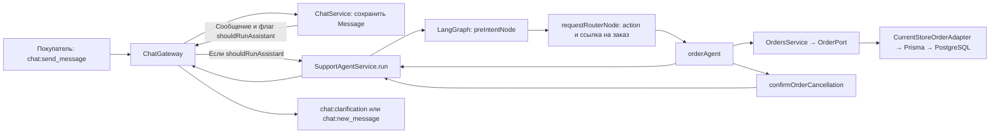
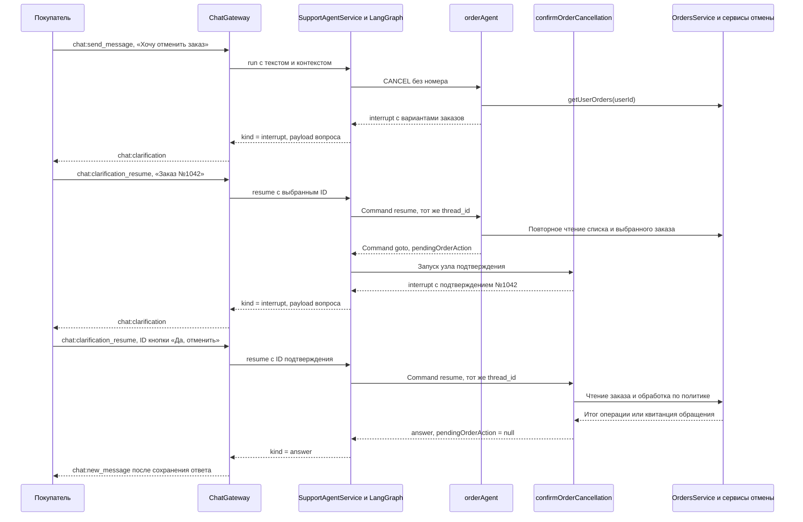

# Order Agent — руководство разработчика

Order Agent отвечает на вопросы покупателя о его заказах и ведёт диалог об отмене. В текущем коде это два узла графа поддержки: `orderAgent` читает заказы и подготавливает действие, а `confirmOrderCancellation` обрабатывает подтверждение. Данные о заказах приходят из PostgreSQL через `OrdersService`. Решение о допустимой отмене принимает серверная политика.

| Что хочет покупатель | Что делает приложение |
| --- | --- |
| «Покажи мои заказы» | Читает заказы покупателя и выводит по строке с номером и статусом. |
| «Где заказ №1038? Дай трек-номер» | По номеру ищет заказ покупателя. При действии `TRACKING` добавляет данные об отправлениях, которые уже сохранены в базе. |
| «Хочу отменить заказ» | При необходимости предлагает выбрать заказ, затем запрашивает подтверждение. По подтверждению отменяет неоплаченный заказ, начинает допустимый возврат оплаты или регистрирует обращение. |

Это сценарии, поддерживаемые кодом. Номера, идентификаторы и данные ниже подобраны для объяснения. Примеры свободного текста показывают, что произойдёт при указанном решении роутера. Ответ модели на конкретную фразу не проверялся. Подробности по исходникам собраны в [техническом справочнике](order-agent-reference.md).

## От сообщения до Order Agent

**Граф** здесь — цепочка функций, между которыми LangGraph передаёт состояние. Функция в цепочке называется **узлом**. **State** — данные текущего диалога, которые узлы читают и обновляют. **Checkpoint** — сохранённое состояние выполнения. Для чата оно привязано к `thread_id`, равному `chatId`.



1. Клиент отправляет `chat:send_message` с `chatId` и `content`. Gateway получает пользователя из проверенного токена, проверяет доступ к чату и сохраняет сообщение через `ChatService`. AI запускается для сообщения владельца чата в режиме `BOT`.
2. `SupportAgentService.run()` передаёт в граф текст, ID сохранённого сообщения, `chatId` и контекст `{ userId }`. Текст становится `query` и добавляется в историю графа как `HumanMessage`.
3. `preIntentNode` обрабатывает простые приветствия, неподходящие сообщения и сбрасывает данные предыдущего запуска. Для обычного вопроса о заказе дальше работает `requestRouterNode`. Роутер обычно получает структурированный результат модели и проверяет его по Zod-схеме. Zod проверяет форму данных во время выполнения.
4. Решение роутера содержит действие, например `TRACKING`, и ссылку на заказ, если она известна. `dispatchWorkers()` передаёт решение узлу `orderAgent`. Действие `CANCEL` запускается отдельно от других workers. Есть и путь из меню уточнения: пункт `order_status` ведёт к `RELEVANT`, а `order_cancel` — к `CANCEL` без номера.

[Приём сообщения](../../src/modules/chat/chat.gateway.ts#L265) · [запуск графа](../../src/support-agent/graph/support-agent.graph.ts#L306) · [роутер](../../src/support-agent/graph/nodes/request-router.node.ts#L249) · [меню заказов](../../src/support-agent/config/clarification.config.ts#L129)

## Как читаются заказы

Worker передаёт `userId` из контекста графа и номер или ID заказа в `OrdersService`. Тот использует **порт** `OrderPort` — интерфейс операций с заказами. В этом приложении порт реализует **адаптер** `CurrentStoreOrderAdapter`: он выполняет Prisma-запросы с фильтром по владельцу и приводит строки базы к `OrderRecord`. В эту форму входят статус, позиции, оплата и отправления. Worker форматирует ответ из полученных полей.

В учебных примерах у покупателя есть такие заказы:

| Номер | Когда создан относительно остальных | Статус и данные |
| --- | --- | --- |
| 1043 | Самый новый | `DRAFT`, платежей и отправлений нет |
| 1042 | До 1043 | `PAID`, оплата картой одним успешным платежом на 6 500 ₽, отправлений нет |
| 1038 | Самый ранний | `SHIPPED`, отправление `IN_TRANSIT`, перевозчик CDEK и трек-номер `1234567890` |

### Сценарий 1. Покупатель спрашивает о своих заказах

При `{ action: 'LIST', orderId: null }` сервис возвращает заказы от новых к старым. Worker соединяет краткие строки:

```text
У вас 3 заказ(а/ов):
1. Заказ №1043 — оформляется.
2. Заказ №1042 — оплачен.
3. Заказ №1038 — отправлен.
```

`LATEST` отвечает про последний созданный заказ, поэтому в примере это №1043. `RELEVANT` сначала сравнивает статусы, затем дату. `SHIPPED` имеет более высокий приоритет, чем `PAID` и `DRAFT`, поэтому релевантным окажется №1038. Так один и тот же набор заказов даёт разные ответы на вопросы «какой был последним?» и «что сейчас с моим заказом?».

[Чтение списка и выбор действия](../../src/support-agent/graph/workers/order-agent.worker.ts#L351) · [ранжирование](../../src/modules/orders/core/order-policy.ts#L56)

### Сценарий 2. Покупатель просит трек-номер №1038

1. Решение `{ action: 'TRACKING', orderId: null, orderNumber: '1038' }` приходит из роутера в worker. Внутренний `orderId` и публичный `orderNumber` — разные поля. Для действий с конкретным заказом worker отклоняет запрос, если переданы оба.
2. `getOrderByNumber(userId, '1038')` ищет числовой номер `1038` у текущего покупателя. Если такого заказа нет, worker отвечает, что заказ не найден среди заказов покупателя.
3. `trackingSummary()` начинает с общего статуса и добавляет строки по каждому отправлению. С указанными данными получится:

```text
Заказ №1038 — отправлен.

Отправление 1 — в пути.
Перевозчик: CDEK.
Трек-номер: 1234567890.
```

Ссылка и предполагаемая дата добавляются, если они заполнены. Пустой массив `shipments: []` даёт «Информации об отправлениях пока нет». `null` или отсутствующее поле означают, что источник не предоставил данные для отслеживания. Текущий Prisma-адаптер включает `shipments` в запрос и отдаёт массив. Свежесть трекинга зависит от записей в базе: worker не запрашивает перевозчика. `GET` и `STATUS` возвращают только краткую строку. Без номера и ID эти три действия используют релевантный заказ.

[Поиск по номеру](../../src/modules/orders/adapters/current-store-order.adapter.ts#L126) · [форматирование трекинга](../../src/support-agent/graph/workers/order-agent.worker.ts#L83) · [выбор цели](../../src/support-agent/graph/workers/order-agent.worker.ts#L171)

## Сценарий 3. Покупатель отменяет заказ

В примере роутер передал `CANCEL` без номера. Worker читает заказы покупателя и оставляет записи с публичным номером и статусом `PAID`, `PROCESSING`, `SHIPPED` или `DELIVERED`. Это список для **выбора**, а допустимость конкретного действия определяется позже. В него попадут №1042 и №1038. При одном кандидате worker сразу переходит к подтверждению, при нескольких показывает до пяти заказов на странице. Выбор `Заказ №1042` указывает цель, но ещё не отменяет её. Если покупатель сразу указал номер, например «Отмени заказ №1043», worker ищет этот заказ без фильтра списка.

**Interrupt** — пауза, которую узел запрашивает через `interrupt(payload)`. В payload находятся вопрос и варианты. **Resume** — продолжение этого запуска по ответу клиента. **Command** — инструкция графу, которая может передать ответ в паузу, обновить State или указать следующий узел.



После выбора worker повторно читает №1042 и записывает в `pendingOrderAction` действие `CANCEL`, внутренний ID, номер, ID пользователя и сгенерированный идентификатор подтверждения. Затем `confirmOrderCancellation` читает заказ и строит вопрос. Кнопка «Да, отменить» получает ID вида `order_cancel_confirm:<uuid>:<orderId>`. Кнопка «Нет» отправляет `order_cancel_decline`. Если в списке больше одного кандидата, можно выбрать другой заказ. Тогда узел снова предлагает подтверждение уже для нового ID.

Клиент отправляет **точный ID из** `options[].id`:

```json
{
  "chatId": "33333333-3333-4333-8333-333333333333",
  "value": {
    "kind": "question_selected",
    "questionId": "order_cancel_confirm:11111111-1111-4111-8111-111111111111:22222222-2222-4222-8222-222222222222"
  }
}
```

Здесь оба ID условные. В реальном запросе `chatId` берётся из текущего чата, а `questionId` из полученного вопроса. Строка «да» в обычном `chat:send_message` не выполняет этот контракт.

| Момент | Что есть в состоянии | Что уже изменилось в бизнес-данных |
| --- | --- | --- |
| Вопрос «Какой заказ?» | `requestRouter.orderRequest.action = 'CANCEL'`, узел остановлен на выборе | Заказ ещё не выбран. Отмена не начата. |
| Вопрос «Вы действительно хотите отменить Заказ №1042?» | `pendingOrderAction` указывает исходную цель. Checkpoint хранит паузу узла подтверждения. | Заказ ещё не изменён. |
| Ответ «Нет» | Узел формирует ответ и очищает `pendingOrderAction`. | Заказ остаётся в прежнем статусе. |
| Подтверждение с актуальным ID | Узел заново читает заказ и вычисляет маршрут. При штатном выходе очищает `pendingOrderAction`. | Результат зависит от маршрута и результата операций с БД и провайдером. |

При возобновлении функция остановленного узла может выполниться с начала. Сохранённый ответ подставляется в соответствующий вызов `interrupt`, поэтому чтения, стоящие перед паузой, выполняются повторно. Например, если список заказов успел измениться, старый вариант может исчезнуть. Код проверяет, что выбранный вариант входит в текущую страницу или совпадает с текущим ID подтверждения.

[Выбор заказа](../../src/support-agent/graph/workers/order-agent.worker.ts#L240) · [создание pending action](../../src/support-agent/graph/workers/order-agent.worker.ts#L402) · [узел подтверждения](../../src/support-agent/graph/workers/order-agent.worker.ts#L457) · [приём resume](../../src/modules/chat/chat.gateway.ts#L532) · [возобновление графа](../../src/support-agent/graph/support-agent.graph.ts#L365)

### Что происходит после «Да»

Узел заново получает заказ с оплатами и отправлениями. `getOrderCancellationPlan(order)` читает их состояние и выбирает маршрут. Например:

| Состояние | Маршрут | Что делает backend |
| --- | --- | --- |
| №1043, `DRAFT`, `payments: []`, `shipments: []` | `DIRECT_CANCEL` | `OrdersService.cancelOrder()` повторяет проверку и обновляет статус. При успехе ответ «Заказ №1043 отменён.» |
| №1042, `PAID`, единственный `SUCCEEDED` на 6 500 ₽, `CARD`, `shipments: []` | `REFUND_BEFORE_SHIPPING` | Создаёт или переиспользует обращение. `RefundService` отдельно проверяет допустимость операции, сохраняет `Refund(PENDING)` и `Order(CANCELLED)` одной транзакцией, затем обращается к YooKassa. |
| №1038, `SHIPPED`, отправление в пути | `INTERCEPT_DELIVERY` | Регистрирует обращение с данными заказа и отправления. Действия у перевозчика код этого сценария не выполняет. |
| Заказ уже в `CANCELLED` | `ALREADY_CANCELLED` | Сообщает, что заказ уже отменён. |

Для маршрутов через обращение пользователь получает текст о принятой заявке. Даже если возврат уже подтвердился или остался в `PENDING`, worker формирует одинаковый ответ: «Заказ №1042: заявка на отмену принята. Возврат денежных средств будет обработан. После оформления возврата срок зачисления зависит от банка». Этот текст означает принятие заявки. Состояние финансовой операции следует смотреть в `Refund`, где результат провайдера записывается отдельно.

[Политика отмены](../../src/modules/orders/core/order-policy.ts#L76) · [сервис обращений](../../src/modules/orders/cancellation/order-cancellation-case.service.ts#L82) · [сервис возврата](../../src/modules/orders/refund/refund.service.ts#L39)

## Как покупатель получает ответ

Одиночный ответ worker формирует из шаблонов, например «Заказ №1038 — отправлен.». Он возвращает объект `{ type: 'order_agent', message, blocks: [] }` и добавляет `AIMessage` в историю графа. При запросе с несколькими workers заказ становится блоком `{ worker: 'order', data: { message } }`. `aggregateAnswer` объединяет такие блоки с результатами других workers, добавляя заголовки разделов. Для отмены роутер оставляет только `orderAgent`.

Gateway преобразует результат графа в события клиента. Пауза отправляется как `chat:clarification`. Ответ сначала сохраняется в таблице сообщений, затем публикуется как `chat:new_message`. Перед публикацией учитываются режим `BOT` и версия handoff, которую Gateway получил до запуска. Это защита доставки ответа при смене режима чата. Операции с заказом имеют собственные проверки и транзакции.

[Форма результата worker](../../src/support-agent/graph/workers/order-agent.worker.ts#L133) · [сборка блоков](../../src/support-agent/graph/nodes/aggregate-final-answer.node.ts#L98) · [публикация результата](../../src/modules/chat/chat.gateway.ts#L755)

## Границы реализованного поведения

- `RETURN_REQUEST`, `EXCHANGE_REQUEST` и `CLAIM_REQUEST` объявлены в схеме, и роутер может их выбрать. Worker завершается ошибкой «неподдерживаемое действие». Вопросы об условиях возврата могут обрабатываться через знания магазина, а денежный возврат при отмене проходит по ветке `CANCEL`.
- Обращение `SupportCase` со статусом `WAITING_OPERATOR` в этом сценарии само по себе не переводит чат в режим оператора и не выполняет остановку доставки, приём возвращённого товара или обмен.
- Исходники показывают сохранение незавершённого `Refund`. Работу отдельного процесса, который гарантированно доводит такие записи до конечного состояния, в текущем коде подтвердить не удалось.

[Контракт действий](../../src/support-agent/schemas/order-request.schema.ts) · [ветки worker](../../src/support-agent/graph/workers/order-agent.worker.ts#L449) · [запись обращения](../../src/modules/orders/cancellation/order-cancellation-case.service.ts#L140) · [обработка ответа YooKassa](../../src/modules/orders/refund/refund.service.ts#L144)
