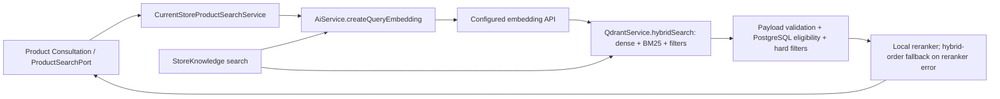

> HISTORICAL SNAPSHOT — preserved research/results, not current deployment instructions. Final pre-commit cleanup (2026-10-23) supersedes runtime/status claims below; see [current implementation](PRODUCTION-AI-REVIEW.md).

# Embeddings Status & Reliability Research — 2026-10-22

**Research only.** No embedding implementation, schema, index, collection or product-search rule was changed. Repository HEAD: `aff28c0ee5912047f524b16db9fd8a262606ecf2`. Findings distinguish source inspection, a local read-only experiment and proposed engineering work. This is not a production incident diagnosis.

## Recommendation

Keep `QdrantService`, `ProductSearchPort` and all existing hard filters. The smallest useful change after review is a bounded embedding request followed by one BM25-only query for an explicitly classified temporary embedding failure. Use the same payload validation, PostgreSQL eligibility checks, reranker and limits. Do not substitute a different embedding model against the existing dense index.

This fallback is technically possible on the inspected local Qdrant. It is not yet implemented or quality-certified. Qdrant failure and a deliberate model migration require separate solutions. For the current small installation, manual recovery/reindexing and honest search-unavailable responses are preferable to an additional retrieval platform.

## 1. Actual execution and persistence paths

Relevant source:

| File | Actual responsibility / failure boundary |
| --- | --- |
| [AiService](../src/ai/ai.service.ts) | Separate query/document methods; Yandex native fetch or OpenAI embeddings SDK. Chat configuration does not select embeddings. |
| [QdrantService](../src/core/qdrant/qdrant.service.ts) | dense + server-side BM25 prefetch, RRF, same filter at both branches and final query; save waits for completion. No keyword-only method today. |
| [QdrantModule](../src/core/qdrant/qdrant.module.ts) | Client URL; no explicit request timeout/auth policy configured here. Installed client default timeout is 300,000 ms. |
| [CurrentStoreProductSearchService](../src/product-consultation/adapters/current-store/current-store-product-search.service.ts) | Resolves catalog filters first. Embedding must complete before hybrid search. Validates/deduplicates hits, checks current PostgreSQL products and hard filters; 20 candidates, 6 final results. |
| [ConsultationWriteOwner](../src/product-consultation/application/runtime/consultation-write-owner.ts) | SearchPort exception is finalized as `search_failed` (or superseded), with the error retained; not a successful empty search. Persistence errors have a separate boundary. |
| [ProductsService](../src/modules/products/products.service.ts) | Create/update product in PostgreSQL, then synchronous semantic extraction → search text → document embedding → PostgreSQL ProductEmbedding upsert → Qdrant upsert. |
| [StoreKnowledgeService](../src/store-knowledge/store-knowledge.service.ts) | Import: PostgreSQL row first, then embedding/Qdrant. Search: query embedding → hybrid → rerank; no product-style reranker fallback. `findByKey`/active keys are PostgreSQL-only. |
| [RerankerService](../src/core/reranker/reranker.service.ts) | Local ONNX inference, with lazy model/tokenizer loading from a local cache or download. It is a separate CPU/memory/cache/network-at-first-load dependency. |
| [Prisma schema](../prisma/schema.prisma) | `ProductEmbedding.vector` is `vector(768)`. |

An embedding failure during create/update can return an error **after the product row changed**; create can also already have uploaded images. A Qdrant failure can occur after the PostgreSQL embedding row changed. There is no transaction spanning these stores. Reindex loops sequentially and stops on the first failure. Knowledge import similarly leaves earlier records committed. Repeating a failed create is not equivalent to retrying just indexing; do not add whole-operation automatic retries.

## 2. Yandex status: evidence and unknowns

There is no active `.env` in this checkout and no observed live Yandex failure log or paid diagnostic request. Therefore **“Yandex Embeddings do not work” is unproven**. The local dense vectors do not carry reliable model provenance; their length does not identify their producer.

Source configuration is explicit: `YANDEX_EMBEDDING_QUERY_MODEL`, `YANDEX_EMBEDDING_DOCUMENT_MODEL`, `YANDEX_FOLDER_ID`, `YANDEX_API_KEY`; dimensions default to **768**. Endpoint is native `https://ai.api.cloud.yandex.net:443/foundationModels/v1/textEmbedding`; request contains `modelUri`, `text`, `dim` as a string. Exact configured URIs and credential type remain unknown.

The official model table distinguishes v1 `text-search-doc/query/latest` (256 dimensions) from v2 `text-embeddings-v2-doc/query/` (128/256/512/768, default 256). Consequently a 768-dimensional deployment must verify the selected model/version, not just this application's default. The API returns `modelVersion`, but our client discards it. [Yandex models](https://aistudio.yandex.ru/ru/docs/ai-studio/concepts/embeddings), [native API](https://aistudio.yandex.ru/en/docs/ai-studio/embeddings/api-ref/Embeddings/textEmbedding).

Potential authentication mismatch: our native request always uses `Bearer` with `YANDEX_API_KEY`. The dedicated authentication reference distinguishes IAM-token `Bearer` from API-key `Api-Key`. The embeddings tutorial itself has an inconsistent Bearer/API_KEY example and later labels the credential an IAM token. Treat this as a concrete configuration hypothesis, **not proof of a current 401**. First identify the credential type without disclosing it, then compare the actual native request with the [authentication reference](https://aistudio.yandex.ru/en/docs/ai-studio/api-ref/authentication). Do not apply Chat Completions authentication assumptions to the native embeddings endpoint.

Other confirmed source risks:

- Yandex fetch has no application timeout/signal and no retry. A stalled request has no bound owned by AiService. Batch documents use unbounded `Promise.all` concurrency.
- HTTP failures become plain `Error` with the status embedded in text. A future fallback must not classify errors by substring matching.
- Success does `embedding.map(Number)` without checking finiteness, expected length or modelVersion. Malformed values can propagate until a downstream store rejects them.
- The OpenAI embeddings client uses SDK defaults: two retries and a 600,000-ms timeout. These are separate from the chat timeout/retries-zero contract. The aggregate operation can take longer than one timeout.
- OpenAI success verifies presence of an embedding, but does not attest dimension, finite elements or model provenance.

## 3. What is actually in local Qdrant

Read-only inspection at `2026-10-22T07:49:14.997Z`, `guest_qdrant` at `127.0.0.1:6333`, server **1.17.0**, commit `4ab6d2ee0f6c718667e553b1055f3e944fef025f`:

| Collection | Full scan | dense | nonempty bm25 | sparse-only query |
| --- | --- | --- | --- | --- |
| products | 20 points | 20 × 768, Cosine | 20, IDF modifier | «кроссовки»: 5 hits, positive scores |
| store_knowledge | 69 points | 69 × 768, Cosine | 69, IDF modifier | «доставка»: 5 hits, positive scores |

Each has one shard, replication factor 1 and write consistency 1. An impossible payload filter returned zero hits in each collection. The audit called only collection metadata, scroll and query endpoints; it made no embedding requests or writes and printed no payload/point IDs. Reproducer: [qdrant-readonly.cjs](provider-conformance/qdrant-readonly.cjs); evidence: `.tmp/provider-research/qdrant-readonly.json`.

This proves local sparse-vector availability and basic query/filter execution. It does not measure Russian recall, stemming behavior, ranking relevance, current-catalog completeness or production data. The query uses `using:'bm25'` with `{text, model:'qdrant/bm25'}` and therefore needs no external dense embedding. [Official server-side BM25 contract](https://qdrant.tech/documentation/inference/inference-bm25/).

`createCollections()` checks names and skips existing collections. It does **not** check dense dimensions, distance, sparse configuration, per-point coverage or embedding identity. `qdrant:init` probes a real embedding and only creates absent collections; it was not executed in this audit. Root Docker Compose uses an unpinned Qdrant image; the observed 1.17.0 is a local fact, not a deployment guarantee.

## 4. Failure matrix: current behavior and proposed first response

| Event | Current behavior | Minimal proposed policy, after review |
| --- | --- | --- |
| Yandex/OpenAI temporary network error, DNS/connect failure, provider 5xx | Search rejects before Qdrant; indexing rejects at embedding step | Bound the request; one BM25 query for reads only, same filters. No second embedding provider call. |
| Temporary 429 rate limit | Yandex throws; OpenAI SDK may retry twice | Classify explicit rate limit, use BM25 on reads; count degradation. No retry storm. |
| 429 quota/budget exhaustion | Provider-specific error, no application distinction | Preserve diagnostics/alert; do not silently treat as transient. Fallback on prolonged quota exhaustion requires explicit product policy. |
| 401/403, invalid model/dimensions/config | Throws, possibly after initial product write | Fail visibly; fix config. Do not conceal with a blanket fallback. |
| Embedding timeout | Yandex no application bound; OpenAI SDK timeout/retries | Separate request timeout from caller cancellation; only timeout may choose BM25. No invented timeout in this research. |
| Caller cancellation | Embedding path currently has no explicit cancellation contract | Propagate cancellation; do not initiate BM25 after cancellation. |
| Invalid vector / unexpected model response | Little client validation; downstream error or incorrect retrieval possible | Validate before search/write; treat as compatibility failure, preserve cause. |
| Qdrant unavailable / timeout | Search fails even if embedding succeeded | BM25 in that same Qdrant is unavailable too. Preserve search_failed; keep PostgreSQL-only capabilities available. |
| BM25 vector/config missing | No existing fallback path | Fallback must fail visibly, not synthesize empty results. Repair/backfill before enabling it. |
| Valid query, truly no candidates | Successful empty search | Preserve existing zero-results business flow; never reinterpret infrastructure failure as zero results. |
| Reranker unavailable | Product: hybrid order; Knowledge: propagates | Preserve current behavior in first patch; review Knowledge separately. Cache/warm local model operationally. |

Fail-open on authorization or exhausted billing is a product choice, not a transport accident. The conservative policy above permits temporary availability degradation while preserving actionable configuration failures.

## 5. Comparison of eight approaches

The following is an engineering assessment for this codebase, not a claim about a specific company's architecture. “Small/medium/large” means operational needs and measured throughput; no arbitrary QPS threshold is assigned.

| Approach | Reliability / code fit | Complexity, load and cost | Reindex / rollback / quality | Appropriate scale |
| --- | --- | --- | --- | --- |
| 1. BM25-only fallback | Survives external embedding outage, not Qdrant outage. Excellent fit for existing sparse index and filters. | Small patch; removes embedding cost during outage; extra timeout before lexical query; Qdrant/reranker load remains. | No reindex where sparse coverage verified. Disable fallback to roll back. Lexical matches lose synonym/semantic recall. | First choice at all sizes; evaluate quality and degraded traffic rate. |
| 2. Replicas of the same embedding model | Covers instance/AZ failure if weights, tokenizer, query/document mode and normalization are identical. Does not fix shared auth/quota/provider outage. | Additional serving replicas, compute and routing; worthwhile only with an actually replicable model/deployment. | No reindex for exactly the same space. Remove replica to roll back. Quality should remain equivalent; verify numeric tolerance. | Medium/high throughput or strict uptime; not needed for this small app yet. |
| 3. Secondary provider with own index | Covers primary embedding provider outage; still shares Qdrant failure domain if hosted there. | High: two embedding bills, index storage, dual writes and health policy. | Full second index/backfill; switch query model and index together. Retain both for rollback. Evaluate different relevance. | Only when BM25 degradation is demonstrably insufficient. |
| 4. Parallel named vectors | Separates model spaces in one collection; avoids duplicate payload. Does not make Qdrant resilient. | Medium/high: dual embedding writes, extra vector storage/HNSW, per-point completeness. Existing service currently always uses `dense`. | Backfill new vector; rollback query `using` plus model. Never mix vectors of different models under one name. | Medium/large experiments or planned migrations; not first outage fix. |
| 5. Blue-green collections + aliases | Strong migration isolation; can preserve old index. Both collections on one node still share outage. | Medium: temporary duplicate payload/vector/index storage, controlled updates/deletes during copy. | Full re-embedding. Switch alias **and query model config** coherently; keep old collection for rollback. | Simplest deliberate model migration for small/medium; same method scales with capacity planning. |
| 6. Local embedding model | Removes external API dependency; adds local CPU/GPU/model-cache failure domain. Reuse existing Qdrant boundary. | Serving/model operations and capacity benchmark; fixed hardware cost versus API input-token charges. | Full reindex for a new space; preserve old index. Russian/domain quality must be measured. | Consider at sustained load, privacy constraints or repeated outages, not just to avoid one provider. |
| 7. Deferred indexing + recovery | Product write can succeed while search index lags. Decouples create/update availability from embedding/Qdrant. | Medium: persisted pending work, idempotency, revision ordering, bounded worker and reconciliation. No new broker required. | No model reindex by itself; repair missing/stale rows. Drain backlog before rollback; search freshness is temporarily lower. | Manual repair first for small volumes; durable pending state when write failures become material. |
| 8. Degraded capabilities on Qdrant outage | Preserve exact PostgreSQL catalog/known-key operations; semantic retrieval unavailable. | Low if reporting unavailable; medium if adding explicit SQL search. SQL capacity and filter parity need tests. | No embedding reindex; switch off fallback. SQL ILIKE/filters are not equivalent to semantic search. | At every scale, separate unavailable from empty; replicated Qdrant only when uptime warrants its cost. |

Supporting primary engineering references: Qdrant describes [model migration and dual representations](https://qdrant.tech/documentation/tutorials-operations/embedding-model-migration/) and [replication/resilience](https://qdrant.tech/documentation/scaling/resilience/); Hugging Face documents [TEI serving, batching and local inference](https://huggingface.co/docs/text-embeddings-inference/index). AWS's [transactional outbox guidance](https://docs.aws.amazon.com/prescriptive-guidance/latest/cloud-design-patterns/transactional-outbox.html) explains the dual-write consistency problem. For this application, the relevant principle is atomic recording of pending indexing alongside a product revision, not adoption of AWS services, Kafka or event sourcing.

Version caveat: the current Qdrant migration guide is tested on 1.19 and documents adding named vectors to existing collections for 1.18+. Our observed server is **1.17**. Do not apply that dynamic-schema procedure unchanged. Predefined named vectors or blue-green collections require their own version-specific verification. Increasing `replication_factor` on this single node does not create an independent failure domain.

Cost relationships, without invented tariffs: embedding API cost scales with total embedded input tokens; unquantized dense storage starts around `points × dimensions × 4 bytes × replicas`, before HNSW/payload/metadata overhead. A second model adds its embedding bill and vector storage. During an outage, embedding wait consumes roughly `request_rate × wait_time` concurrent operations. BM25 fallback reduces external cost but requires an explicit wait bound to protect application capacity. Local inference economics depend on measured batch throughput, hardware utilization and model size.

## 6. Planned change of embedding model is not outage fallback

Equal dimensions do not imply equal coordinates: two models can map the same concept in different directions and use different tokenization, normalization or query/document training. Cosine distance between a query from model B and documents from model A is not a meaningful retrieval contract. Query/doc models may deliberately differ only when designed as a compatible pair; pair and version must stay consistent.

OpenAI `text-embedding-3-small` defaults to 1536 and `text-embedding-3-large` to 3072; supported models allow requested reduced dimensions. This application explicitly defaults its OpenAI request to 1536, which conflicts with PostgreSQL `vector(768)` and the inspected Qdrant 768-vector collections. Selecting 768 can fix storage shape, **not semantic compatibility**. [Official embedding guide](https://developers.openai.com/api/docs/guides/embeddings).

Recommended migration, separately approved: choose model + query/doc conventions + dimension, build a new collection from authoritative PostgreSQL/search text, validate coverage/hard filters/relevance, coordinate updates/deletes, switch model config and collection target together, then keep the old target through rollback verification. The fixed PostgreSQL vector column also needs a deliberate plan: retain 768 and replace embeddings with provenance/versioning, or migrate storage shape. Never overwrite only the query provider and leave old documents in place.

An alias switch can be atomic within Qdrant; it cannot atomically restart NestJS with another embedding model. Coordinate both, for example with a short controlled traffic/write pause for this small deployment. Existing physical collection names also cannot simultaneously be aliases of the same name; plan a distinct stable alias rather than deleting a live collection. No migration or alias changes were performed here.

## 7. Exact first-patch proposal — not applied

| File | Minimal proposed change |
| --- | --- |
| `src/ai/ai.service.ts` | Bound embedding HTTP waiting, preserve typed status/code/cause, validate finite values and requested dimensions. Distinguish timeout from caller cancellation. Fix auth only after actual credential type is established. Align OpenAI embedding retries/timeouts deliberately; no generic retry manager. |
| `src/core/qdrant/qdrant.service.ts` | Add `keywordSearch(collection, query, limit, filter)` using existing `bm25`, `qdrant/bm25`, `with_payload:true` and identical filters. No dense vector argument and no second dense request. Validate expected existing collection settings before enabling fallback. |
| `src/product-consultation/adapters/current-store/current-store-product-search.service.ts` | Catch only the embedding call's explicit transient errors. Choose hybrid on success, keyword search once on eligible failure, then share the existing validation/dedup/PG/hard-filter/reranker path. Do not wrap the whole search in a catch that masks DB/schema errors. |
| `src/store-knowledge/store-knowledge.service.ts` | Separate optional follow-up using the same technical retrieval primitive and its own active/category filters; do not silently change its current reranker/error policy. |
| Corresponding isolated specs | Fault-injection and filter-parity tests below; no external model charges. |

Timeout value must follow the enclosing search budget and measured latency. This report does not choose an arbitrary global duration. Emit a small degradation/error metric through existing logging, excluding query text/secrets; no observability platform required. Keep `ProductSearchPort` result schemas unchanged; explicit user-facing degradation wording, if desired, needs its own product decision.

Acceptance tests before enabling:

1. Success sends one embedding request and one hybrid query; existing results and hard filters unchanged.
2. Temporary 429/5xx/connect failure/timeout selects exactly one sparse query, with zero additional embedding requests; recovery returns to hybrid on the next operation.
3. 401/403/config/quota/malformed vector and programmer errors retain their category and do not silently fall back; cancelled calls issue no new query.
4. Verify brand/category/gender/size/price/store/active/availability restrictions both at Qdrant and authoritative PostgreSQL stages, including stale Qdrant payloads.
5. Empty sparse results remain legitimate empty search; sparse/Qdrant errors remain search_failed. A Qdrant outage never triggers recursive fallback.
6. Concurrent failures stay bounded; each request has isolated signals; no product writes/tools replay and no late success after cancellation.
7. Real local Qdrant sparse coverage and supported server version checked, without any dense call. Missing sparse vector/config is observable.
8. Russian ecommerce evaluation set: synonyms, exact brands, sizes, misspellings, broad/rare queries. Compare top-k relevance and zero-result rates against hybrid. Read-only smoke hits alone are insufficient.

For the current project, this proposal is the first useful availability improvement. Durable deferred indexing and an embedding migration are separate decisions with different consistency and quality risks; neither was implemented under this research task.
