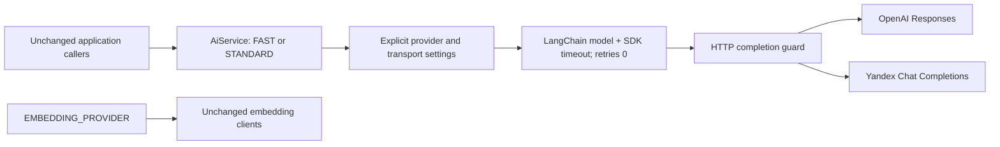

# Direct AI provider configuration

Application code continues to use `AiService.getChatModel('FAST' | 'STANDARD')`.
Each role selects its own provider/model. There is no gateway, budget database,
automatic fallback, custom authentication or execution/deadline manager.
`STRONG` stays reserved and throws if requested.



## Configuration and switching

```dotenv
CHAT_FAST_PROVIDER=yandex
CHAT_FAST_MODEL=gpt://<folder-id>/yandexgpt-lite/latest
CHAT_STANDARD_PROVIDER=openai
CHAT_STANDARD_MODEL=gpt-6.1-sol
YANDEX_API_URL=https://ai.api.cloud.yandex.net/v1
YANDEX_API_KEY=<secret>
OPENAI_API_KEY=<secret>
CHAT_REQUEST_TIMEOUT_MS=60000
EMBEDDING_PROVIDER=yandex
```

Both providers may serve either role. Configure both roles and their credentials,
then restart the application. Models are cached by role; there is no hot reload.
Keep all existing embedding models/dimensions/credentials independently.
Manual configuration switching is implemented; automatic fallback is not.
Switching providers for active conversations with provider-specific reasoning
history is not certified. Do not silently strip that history to switch models.

Provider selection is validated at construction; model/profile/credentials and
Yandex URL are checked when the role is first requested. Invalid explicit settings
fail instead of selecting another deployment. Real `.env` files were not changed.

## Legacy environment migration

| Setting | Preferred | Deprecated fallback, only when preferred variable is absent |
| --- | --- | --- |
| Provider | `CHAT_FAST_PROVIDER`, `CHAT_STANDARD_PROVIDER` | `CHAT_PROVIDER` |
| Model | `CHAT_FAST_MODEL`, `CHAT_STANDARD_MODEL` | Selected provider's `YANDEX_LITE_MODEL` / `YANDEX_MODEL`, or `OPENAI_FAST_MODEL` / `OPENAI_STANDARD_MODEL` |
| OpenAI alias profile | `CHAT_<ROLE>_TRANSPORT_PROFILE` | `OPENAI_<ROLE>_TRANSPORT_PROFILE` |

Empty/null/invalid preferred values are errors. When both sets exist, explicit new
values win; legacy models are never substituted across providers. No model ID has
an invented default. `AI_PROVIDER` and `OPENAI_CHAT_MODEL` are not fallbacks.
`CHAT_MODE` may be absent or `direct`. `gateway` now fails with a migration error:
supply direct credentials and role settings before changing it. `LITELLM_*` and
budget settings have no runtime consumer. Ignored env files remain untouched.

## Transport contracts and new models

| Deployment | API | Reasoning | Temperature | State |
| --- | --- | --- | --- | --- |
| `gpt-6-luna` | Responses | `none` | `0` | `store:false`, encrypted reasoning history |
| `gpt-6.1-sol` | Responses | `medium` | Omitted | `store:false`, encrypted reasoning history |
| Configured Yandex URI | Chat Completions | Omitted | `0` | Application message/tool history |

Parameters are preserved from Phase 2 and verified on the wire offline.
`zdrEnabled` sets `store:false`; it does not enable account-level ZDR.
Explicit `include: ['reasoning.encrypted_content']` remains for the installed SDK.
Profiles belong to deployments, not roles; do not infer them from name prefixes.

An alias of a validated OpenAI deployment needs `CHAT_<ROLE>_TRANSPORT_PROFILE`
equal to `gpt-6-luna` or `gpt-6.1-sol`. A known model with a conflicting profile is
rejected. Yandex optionally accepts `yandex-chat`; an OpenAI profile on Yandex fails.
A new model family requires an explicit entry in `chat-transport.ts` and contract/
live conformance checks. Do not mislabel a new family as an existing profile.

## Future providers and public model type

The return type is the existing LangChain `BaseChatModel`; current instances remain
`ChatOpenAI`. No new interface hierarchy was added. Existing `invoke`, `bindTools`,
`withStructuredOutput`, callbacks and graph events are unchanged. The base class
alone does not guarantee an adapter implements every feature: test the exact
methods/options used by the application.

For Qwen/GigaChat later, use a maintained compatible LangChain integration, add its
construction and explicit configuration inside the AI module, and run the same
contracts. Let the provider SDK own auth/token refresh. No universal SDK, registry
framework or custom auth service is needed. Future providers are not implemented
or certified here. Extending chat providers must not change embedding selection.

## Reliability behavior

- SDK retries are `0`; no provider fallback or graph/tool replay is added.
- `CHAT_REQUEST_TIMEOUT_MS`: positive integer, 1..2147483647, default 60000 ms.
  This deliberately replaces the previous direct SDK default of 600000 ms. It is
  a technical limit for one HTTP request, not a measured consultation SLA.
- The SDK owns the timer/controller. Custom fetch reads the complete response body
  before returning, including errors, so the SDK timeout covers headers AND body.
  There is no second timeout/deadline manager. Repair/tool rounds are separate calls.
- HTTP status, headers, original bytes, error code and request ID reach the SDK.
  Transport errors are not repaired here.
- Explicit AbortSignal is checked before send and after receiving/reading. Late
  replies from fetch implementations ignoring abort are discarded. This does not
  prove the remote provider stopped computing or charging.
- Malformed/incomplete Responses and unfinished output items are rejected before
  parsing/tools. Missing/null/unknown/truncated Chat Completions finish reasons are
  rejected too. Guard errors appear as `ChatTransportError` in the SDK error cause.
  The guard never rewrites or repairs output.
- Completed refusal content passes unchanged to LangChain, never as structured
  success. Installed LangChain 1.5.6 loses the Yandex refusal field; its existing
  empty/parsed-null behavior remains. No new semantic workaround is introduced.
- Provider streaming stays disabled so the guard can inspect a complete reply.
  LangGraph custom/v3 events still work. Unsupported streaming is rejected.
- Existing schemas, Zod validation, `includeRaw`, tools and structured-output modes
  are retained. No global strict-mode or domain normalization change was made.
- Existing usage callbacks remain. Unknown usage is unknown, not free execution.
  There is no budget enforcement or hard-cap/accounting guarantee.

## Known application limitations

Workspace's broad repair catch and Handoff retries remain separate tasks.
LangGraph 1.4.9 can lose node-local cancellation in nested execution; removing the
unused Phase 4 context does not fix this. Existing graph timeouts are unchanged.
One Socket.IO disconnect still does not cancel the durable conversation. There is
no whole-operation deadline, tool rollback or exactly-once business execution.
Historical Phase 4 findings remain in `infra/litellm/RELIABILITY.md`.

## Verification and live conformance

```powershell
node node_modules/jest/bin/jest.js --runInBand --testPathPattern=src/ai
node --test src/ai/testing/direct-http.integration.cjs
node node_modules/typescript/bin/tsc --noEmit --incremental false -p tsconfig.build.json
```

Tests cover all role/provider pairs, credentials, GPT-6 parameters, schemas/Zod,
tools, reasoning history, events, errors, abort, timeout, no retries and independent
embeddings. Native HTTP tests use only a disposable loopback server, including
stalled headers, success/error bodies and socket closure. No paid APIs are called.

Offline success is not production certification. With explicit approval for paid
calls, check exact model IDs/access, auth/TLS/CA, real application schemas, forced
tools/results, reasoning history, refusal, truncation, latency/timeout suitability,
usage and provider billing after abort. Verify production Node/SDK versions and
quotas. Switching active conversations needs separate history compatibility checks.

See [SIMPLIFICATION.md](SIMPLIFICATION.md) for exact file inventory, results and
the verified local Phase 4 recovery path. Business modules were not modified.
